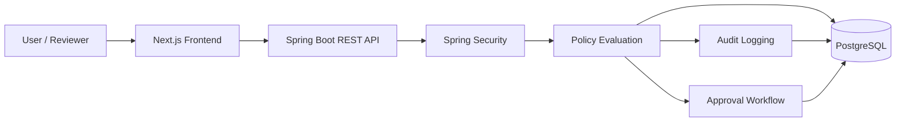

SentinelAI — AI Agent Governance Platform
SentinelAI is a governance layer for AI agents. It evaluates agent actions against configured permissions, records decisions in audit logs, and routes sensitive actions for human approval.
Status: Local development and manual API/UI flows have been tested. Production deployment and production-grade credential management remain separate tasks.

Features
- Policy evaluation: Returns decisions such as ALLOW, DENY, or APPROVAL_REQUIRED.
- Agent permissions: Example agents include reader-agent, analyst-agent, and payment-agent.
- Human-in-the-loop approvals: Reviewers can approve or reject approval requests.
- Audit logs: Reviewer-only access to recorded events.
- Access control: Spring Security with HTTP Basic authentication and role restrictions.
- Database migrations: Flyway-managed schema changes.
- Web interface: Frontend policy playground for interacting with the API.
Architecture

Tech Stack
Layer	Technologies
Frontend	Next.js, React
Backend	Java 21, Spring Boot
Security	Spring Security, HTTP Basic authentication, role-based authorization
Database	PostgreSQL, JPA / Hibernate
Migrations	Flyway
Build and tests	Maven Wrapper, JUnit / Spring test support

Example Policy Decisions
Agent	Action	Expected decision
reader-agent	READ_DOCUMENT	ALLOW
reader-agent	MAKE_PAYMENT	DENY
analyst-agent	CALCULATE	ALLOW
payment-agent	MAKE_PAYMENT	APPROVAL_REQUIRED

These examples reflect the current development configuration.
API Endpoints
Local backend URL: http://localhost:8080
Method	Endpoint	Purpose
GET	/actuator/health	Health check
POST	/api/v1/policies/evaluate	Evaluate an agent action
GET	/api/v1/audit-logs	Retrieve audit logs; reviewer role required
GET	/api/v1/approvals	Retrieve approval requests
POST	/api/v1/approvals/{id}/approve	Approve a request; reviewer role required
POST	/api/v1/approvals/{id}/reject	Reject a request; reviewer role required

Protected endpoints require HTTP Basic authentication. Refer to the backend controller and DTO classes for exact request/response schemas.
Getting Started
Prerequisites
- Java 21
- Node.js and npm
- PostgreSQL
- Git
1. Clone the repository
git clone https://github.com/hargb/SentinelAI.git
cd SentinelAI
2. Configure PostgreSQL and environment variables
Create a PostgreSQL database named sentinelai, or update DB_URL to match your setup.

In PowerShell, set the following variables in the same terminal used to start the backend:
$env:DB_URL = "jdbc:postgresql://localhost:5432/sentinelai"
$env:DB_USERNAME = "postgres"
$env:DB_PASSWORD = "<your-postgres-password>"
$env:SENTINEL_DEV_PASSWORD = "<your-reviewer-password>"
$env:SENTINEL_READER_PASSWORD = "<your-reader-password>"
Replace the placeholders with your own local credentials. Never commit real credentials.
3. Start the backend
cd sentinelai-api
.\mvnw.cmd spring-boot:run
The backend should be available at http://localhost:8080. Check the health endpoint at http://localhost:8080/actuator/health.
4. Start the frontend
Open a second terminal from the repository root:
cd frontend
npm install
npm.cmd run dev
Open http://localhost:3000.

If the frontend needs environment variables, create a local .env.local using the variable names referenced by the frontend code. Keep it out of version control.
Run Tests
From the backend directory, with PostgreSQL running and the required environment variables configured:
.\mvnw.cmd test
Security Notes
- Never commit .env, .env.local, passwords, API keys, or Basic Auth credentials.
- Use HTTPS for authentication outside local development.
- Do not use {noop} password encoding or development credentials in production.
- Use least-privilege roles and enforce authorization on sensitive endpoints.
- Rotate any credential exposed in logs, screenshots, terminal history, or chat.
Roadmap
- [ ] Add API request/response examples and automated integration tests.
- [ ] Add frontend screenshots and a more detailed UI guide.
- [ ] Harden production authentication and secrets management.
- [ ] Add Docker Compose for the frontend, backend, and database.
- [ ] Set up deployment, HTTPS, monitoring, and CI/CD.
Contributing
1. Fork the repository.
2. Create a feature branch.
3. Make focused changes and add tests where appropriate.
4. Open a pull request with a summary and testing notes.
License
No license is specified yet. Until a license is added, assume the repository's code is not granted an open-source license.
